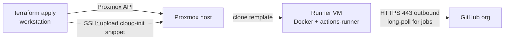
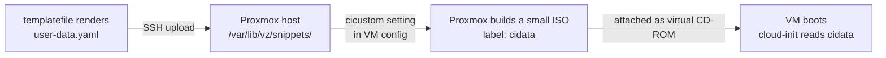
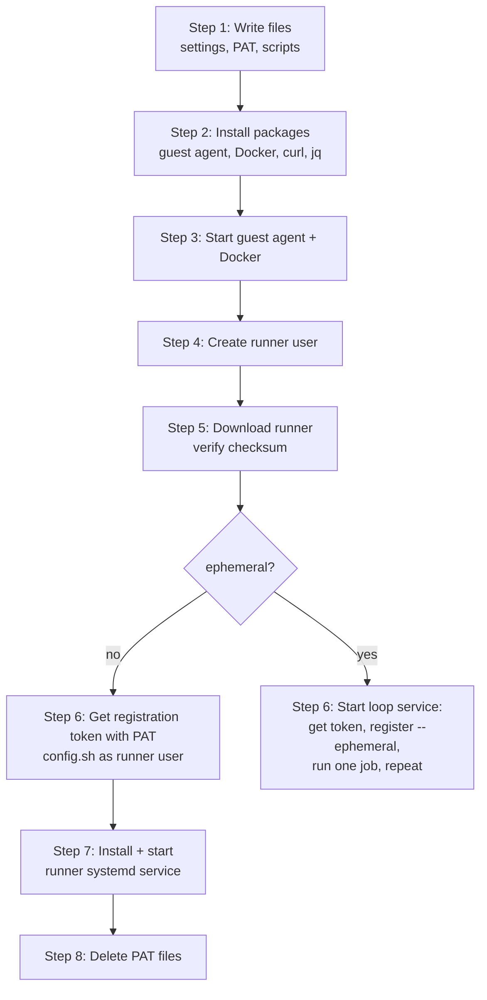
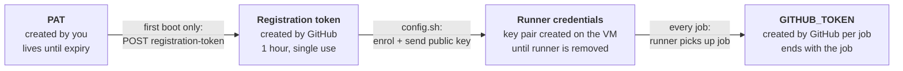
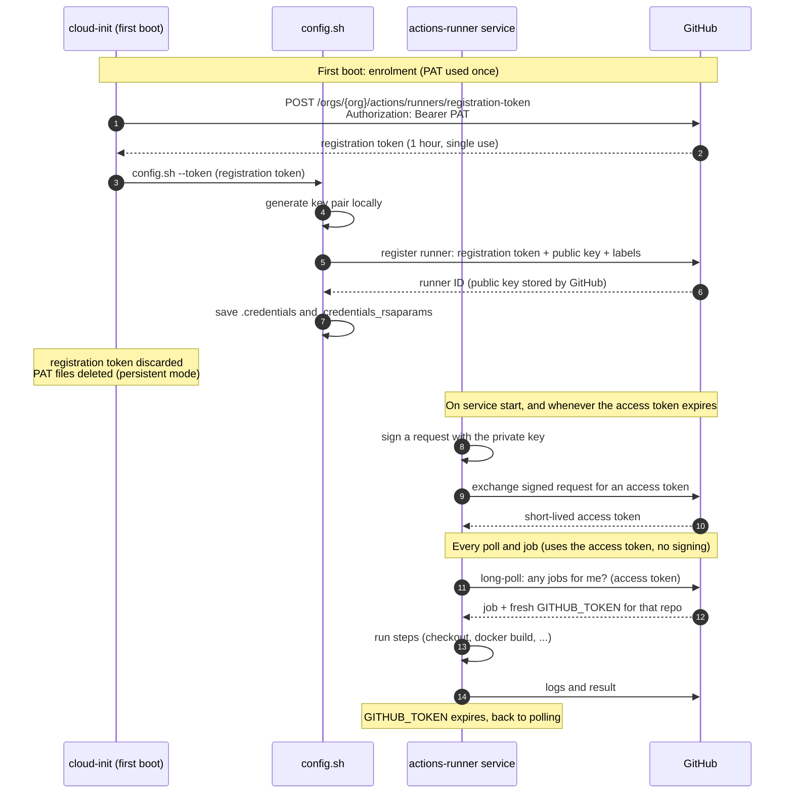
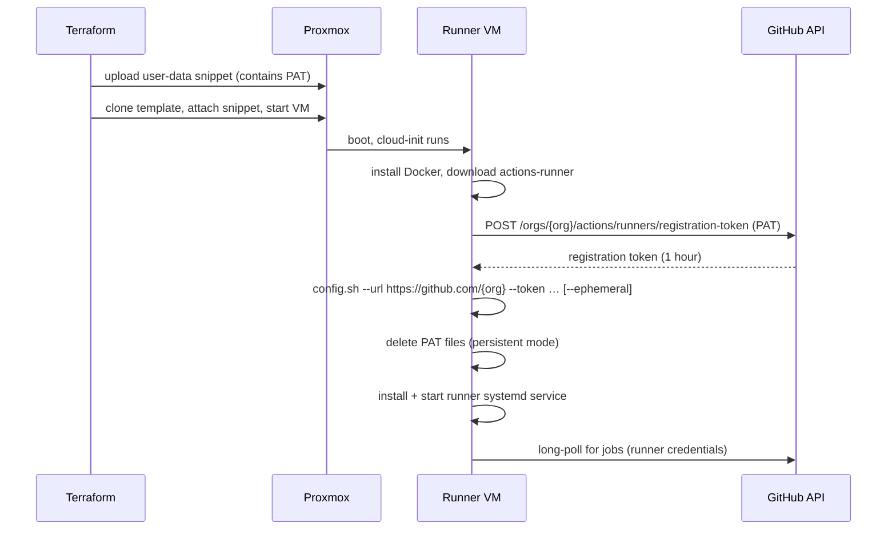

# GitHub Actions runner (Proxmox + Terraform)

> **Status:** implemented, not yet deployed. `terraform validate` passes; the first real `apply` is still to come.

| File | Purpose |
|---|---|
| `versions.tf`, `providers.tf` | Terraform and `bpg/proxmox` provider setup (API token + SSH for snippet upload) |
| `variables.tf` | All inputs. See [Key variables](#key-variables) |
| `main.tf` | The user-data snippet and the VM |
| `outputs.tf` | VM ID, IP addresses, link to the Runners page |
| `cloud-init.yaml.tftpl` | cloud-init user-data template |
| `scripts/` | Scripts that cloud-init installs in the VM (see [What cloud-init does inside the VM](#what-cloud-init-does-inside-the-vm)) |
| `terraform.tfvars.example` | Copy to `terraform.tfvars` (gitignored) and fill in |

Terraform provisions an Ubuntu VM on the Proxmox host. On first boot, cloud-init installs Docker and the GitHub Actions runner and registers it as an **organization-level** runner. Any repo in the org can then run CI jobs on it.

The runner only makes outbound HTTPS connections to GitHub. It needs no inbound ports, port forwarding or public IP, so it works behind NAT.

## Architecture



| Component | Role |
|---|---|
| `bpg/proxmox` provider | Clones the template VM, sets CPU/RAM/disk/network, attaches the cloud-init user-data |
| Ubuntu cloud image template | Base image on Proxmox. Ships with cloud-init but not Docker or the runner. Created once by hand (see Prerequisites) |
| cloud-init user-data | Installs Docker and the runner, gets a registration token, installs the systemd service |
| Runner systemd service (`actions.runner.<org>.<name>`) | Long-polls GitHub for jobs from any allowed repo in the org and runs them as the `runner` user |

## How first-boot setup works

Terraform never logs into the VM or installs anything in it. It delivers a config file, and **cloud-init**, which is preinstalled in the Ubuntu cloud image, carries it out on first boot.



1. **Render.** `templatefile()` fills the org name, PAT and labels into `cloud-init.yaml.tftpl` on your workstation.
2. **Upload.** `proxmox_virtual_environment_file` (`content_type = "snippets"`) copies the result over SSH to the Proxmox host. The Proxmox API can't write snippets, so the provider needs SSH access.
3. **Attach.** The VM's `initialization.user_data_file_id` points at the snippet. Proxmox records this in the VM config as `cicustom`.
4. **Pack.** When the VM starts, Proxmox builds a small ISO labelled `cidata` containing `user-data` (the snippet, unchanged), `meta-data` and `network-config` (both generated by Proxmox), and attaches it as a CD-ROM.
5. **Run.** cloud-init in the guest finds the `cidata` disk and runs the user-data: install packages, write files, then the `runcmd` shell steps. It records that it has finished, so reboots don't run it again.

Your snippet *replaces* the user-data Proxmox would generate from its own fields (username, SSH keys, password). Your SSH public keys therefore go into the user-data itself, via the `ssh_public_keys` variable.

`terraform apply` finishes once the VM is running and the QEMU guest agent reports its IP address. It doesn't know whether the rest of cloud-init worked, so check the Runners page or `/var/log/cloud-init-output.log`.

To make rebuilds predictable, the VM uses `lifecycle { replace_triggered_by = [<snippet resource>] }`. Any change to the user-data replaces the VM instead of updating it in place.

### Who does what

| Step | Who | Where |
|---|---|---|
| Clone the **plain Ubuntu template** into a new VM (full clone, independent of the template) | Proxmox, told to by Terraform | Proxmox host |
| Apply CPU, RAM, disk and network settings, and attach the cloud-init disk | Proxmox, told to by Terraform | Proxmox host |
| Start the VM | Proxmox, told to by Terraform (`started = true`) | Proxmox host |
| Install Docker and the runner, register it, start the service | **cloud-init** | **Inside the VM** |

The template has nothing specific to the runner: just Ubuntu and cloud-init. The VM becomes a runner only because of the user-data attached to it. On first boot, cloud-init also gives each clone its own identity (hostname, SSH host keys, machine ID), and Proxmox gives each clone its own MAC address.

### Starting and restarting

You never need to start anything by hand:

| Situation | What starts it | Setting |
|---|---|---|
| After `terraform apply` | Terraform | `started = true` (provider default) |
| After the Proxmox host reboots | Proxmox | `on_boot = true` (set explicitly) |
| The runner, after the VM reboots | systemd | Service enabled by cloud-init at first boot |

## What cloud-init does inside the VM

Everything below runs on **first boot only**, as root, in this order. Output goes to `/var/log/cloud-init-output.log`.



| # | Step | Done by | Details |
|---|---|---|---|
| 1 | **Write files** | `write_files` | `/etc/github-runner/runner.env`: org, runner name, group, labels, version, checksum, mode (not secret). `/etc/github-runner/pat`: the PAT, owner `root`, mode `0600`. Plus the scripts from `scripts/` into `/usr/local/sbin/` and the ephemeral systemd unit |
| 2 | **Install packages** | `apt`, `packages` | `qemu-guest-agent` (cloud images don't include it), `curl`, `jq`, `ca-certificates`, and Docker Engine from Docker's official apt repo (`docker-ce`, plus the `buildx` and `compose` plugins). Your SSH keys go on the default `ubuntu` user for admin access |
| 3 | **Start services** | `runcmd` | Start `qemu-guest-agent` and `docker`. Once the guest agent is up, Proxmox can see the VM's IP and `terraform apply` finishes |
| 4 | **Create user** | `github-runner-setup` | `runner`, a member of the `docker` group, with no password and no sudo. Created by the script, not cloud-init's `users` module, because the `docker` group only exists after step 2 |
| 5 | **Download the runner** | `github-runner-setup` | The pinned `runner_version` tarball from `github.com/actions/runner/releases`, checked against `runner_sha256`, extracted to `/opt/actions-runner`, owned by `runner`. Then `./bin/installdependencies.sh` installs the runner's own system libraries |
| 6 | **Register** | `github-runner-setup` → `github-runner-token` | `github-runner-token` POSTs to `/orgs/{org}/actions/runners/registration-token` with the PAT. The PAT is passed to `curl` on stdin, so it never appears in the process list, and 401/403 errors are explained clearly in the log. Network errors are retried 5 times; auth errors aren't. Then, **as the `runner` user** (`config.sh` refuses to run as root): `config.sh --unattended --url https://github.com/{org} --token … --name … --runnergroup … --labels … --replace`. The token is held in a shell variable and never printed |
| 7 | **Install the service** | `github-runner-setup` | `./svc.sh install runner && ./svc.sh start` creates and starts a systemd unit that runs as `runner` and starts on every boot |
| 8 | **Remove the PAT** (persistent mode) | `github-runner-setup` | Shreds `/etc/github-runner/pat` and deletes cloud-init's cached `user-data.txt*`. The `cidata` CD-ROM still holds a copy (see [Secrets](#secrets)) |

`--replace` means a rebuilt VM with the same runner name takes over the old runner entry instead of leaving a duplicate.

**Ephemeral mode** replaces steps 6 to 8 with `github-runner-ephemeral.service`, which runs `github-runner-ephemeral` as root in a loop: get a registration token, `config.sh --ephemeral` as `runner`, `run.sh` as `runner` (exits after one job), repeat. If getting a token fails, it waits 30 s (network errors) or 5 min (auth errors) and tries again. It needs the PAT for every job, so step 8 is skipped.

If registration failed on first boot (for example because of a bad PAT), you can retry on the VM without rebuilding: write a valid PAT to `/etc/github-runner/pat` (`0600`, root) and run `sudo github-runner-setup`. Once the problem is fixed in `terraform.tfvars` too, the next rebuild will work on its own.

### Files on the VM

| Path | Contents | Owner |
|---|---|---|
| `/opt/actions-runner/` | Runner binaries, `config.sh`, `run.sh`, `svc.sh` | `runner` |
| `/opt/actions-runner/.runner`, `.credentials`, `.credentials_rsaparams` | Runner settings, runner ID, **private key** | `runner` |
| `/opt/actions-runner/_work/` | Job workspaces (checked-out repos, build output) | `runner` |
| `/etc/systemd/system/actions.runner.<org>.<name>.service` | Service unit created by `svc.sh` (persistent mode) | `root` |
| `/etc/systemd/system/github-runner-ephemeral.service` | Loop service (ephemeral mode; installed but disabled in persistent mode) | `root` |
| `/etc/github-runner/runner.env` | Non-secret runner settings | `root`, `0644` |
| `/etc/github-runner/pat` | PAT. Deleted after registration in persistent mode | `root`, `0600` |
| `/usr/local/sbin/github-runner-{setup,token,ephemeral}` | Scripts from `scripts/` | `root` |
| `/var/lib/docker/` | Docker images and build cache (the "warm cache") | `root` |
| `/var/log/cloud-init-output.log` | Output of the whole first-boot setup | `root` |

## Tokens

There are four separate credentials. Each one is narrower and shorter-lived than the one that produces it.



| Credential | Created by | Can do | Lifetime | Where it lives |
|---|---|---|---|---|
| **PAT** | You, in GitHub settings | Register and remove runners in the org (**Self-hosted runners** permission only) | Until its expiry date | tfvars, state, Proxmox snippet, cloud-init disk (see [Secrets](#secrets)) |
| **Registration token** | GitHub, when the VM calls the API with the PAT | Register one runner | 1 hour, used once | Only in memory during `config.sh` |
| **Runner credentials** | `config.sh` on the VM, during registration | Poll for and run jobs, as this one runner | Until the runner is removed | `/opt/actions-runner/.credentials*` (private key never leaves the VM) |
| **`GITHUB_TOKEN`** | GitHub, for each job | What the workflow's `permissions:` block allows, on that repo | Ends with the job | Injected into the job |

### PAT vs registration token vs runner credentials

These three are easy to confuse, but each has a different job:

- **PAT: who you are.** It acts as your user, within the permissions you gave it. Here it's used for one thing only: asking GitHub for a registration token.
- **Registration token: permission to join.** It proves that someone with the right access approved adding a runner to this org. It can't do anything else, expires after an hour, and is used once.
- **Runner credentials: who the runner is.** This is the runner's own identity once it has joined. It's used for every poll and every job, for as long as the runner exists.

**Why not use the PAT to get the runner credentials directly?** Runner credentials aren't something GitHub hands out. During registration, `config.sh` **generates a key pair on the VM** and sends only the public key to GitHub, together with the registration token. The private key never leaves the VM. After that, the runner proves its identity by signing a request with that key and exchanging it for a short-lived access token. There's nothing a PAT could fetch.

**Why have a registration token at all instead of passing the PAT to the enrolment step?**

| Reason | Effect |
|---|---|
| Separation | The runner software never needs your account token. An admin can create a registration token in the UI and give it to a script or another person without giving away account access |
| Small blast radius | A registration token that leaks in logs or shell history expires in an hour and can only add a runner |
| Each runner can be revoked separately | Each runner has its own identity. Removing one machine on the Runners page doesn't require rotating a PAT that other things may use |

`config.sh` also accepts `--pat` and requests the registration token itself. That's the same two-step exchange done internally. The cloud-init here makes the `curl` call explicitly, so a 401 or 403 is clearly visible in `/var/log/cloud-init-output.log`.

### How the credentials are exchanged



### Registration flow



The VM gets its own registration token at boot rather than Terraform creating it, because the token expires after one hour. If Terraform created it, it would be in state and would be stale on any later rebuild.

## Runner modes

Set with the `ephemeral` variable.

| | Persistent (default) | Ephemeral (`ephemeral = true`) |
|---|---|---|
| Registration | Once, at first boot | Before every job |
| PAT on the VM | Deleted after registration | **Kept**, so it can register again after each job |
| `_work` directory | Reused between jobs | Fresh registration each time |
| Docker images and package cache | Kept (warm, fast builds) | **Also kept**, because the VM isn't rebuilt |

Ephemeral mode gives a clean runner registration for each job, but **not a clean VM**. Anything a job leaves in Docker, `/tmp` or system packages is still there for the next job. That's acceptable because the runner only runs trusted code.

## Prerequisites

1. **GitHub organization.** Create a free org and create or transfer the repos that should use the runner. After a transfer, GitHub redirects the old URLs, but update hard-coded references such as the ArgoCD `repoURL`s in `cluster-system/argocd-infra/`.
2. **Ubuntu cloud-init template on Proxmox.** Import an Ubuntu cloud image (for example `noble-server-cloudimg-amd64.img`, not the installer ISO) as a VM, add a cloud-init drive, turn on the VM's *QEMU Guest Agent* option, and convert it to a template. The agent package itself is installed by cloud-init. Terraform references it by VM ID.
3. **Snippets enabled on a datastore.** For example, enable the `snippets` content type on `local` (Datacenter → Storage → Edit → Content).
4. **Proxmox API token** for Terraform, with permission to clone VMs and write to the datastore.
5. **SSH access to the Proxmox host** from where you run Terraform (used for the snippet upload).
6. **Fine-grained PAT:**
   - Org: *Settings → Personal access tokens* → allow fine-grained tokens (and approve the token if approval is required)
   - Token: Resource owner = **the org**
   - Permission: **Organization → Self-hosted runners → Read and write**. Nothing else
   - Expiry: set one, and put a reminder in your calendar to rotate it
7. **Org Actions settings for public repos** (see [Public repositories](#public-repositories)):
   - *Runner groups → Default* → allow public repositories
   - *Actions → General* → require approval for **all external contributors** on fork pull request workflows

## Usage

```sh
cd terraform/github-runner
cp terraform.tfvars.example terraform.tfvars   # fill in values; this file is gitignored
ssh-add -l                                     # your Proxmox host key must be loaded in ssh-agent
terraform init
terraform plan
terraform apply
```

`apply` takes a few minutes: it waits until cloud-init has installed the guest agent. Registration finishes a minute or two after that. The runner should then show up as **Idle** under *Org → Settings → Actions → Runners* (the `runners_page` output links there). Target it from a workflow with:

```yaml
runs-on: [self-hosted, linux, homelab]
```

To test it, add this to a private repo in the org and run it from the Actions tab:

```yaml
# .github/workflows/runner-test.yml
on: workflow_dispatch
jobs:
  test:
    runs-on: [self-hosted, linux, homelab]
    steps:
      - run: hostname && docker version
```

### Onboarding a new repo

Create the repo in the org, or transfer it there, and use the `runs-on` labels above. You don't need to change Terraform, rebuild the VM or use the PAT.

For a **public** repo, use the fork-aware `runs-on` expression from [Public repositories](#public-repositories) instead of the plain labels.

### Key variables

Full list with descriptions in `variables.tf`.

| Variable | Purpose | Default |
|---|---|---|
| `proxmox_endpoint` | Proxmox API URL | — |
| `proxmox_api_token` | `user@realm!tokenid=secret` (sensitive) | — |
| `proxmox_insecure` | Skip TLS verification (self-signed certificate) | `true` |
| `proxmox_ssh_username` | SSH user for the snippet upload | `root` |
| `proxmox_node` | Node to create the VM on | — |
| `template_vm_id` | ID of the cloud-init template | — |
| `snippets_datastore` | Datastore with snippets enabled | `local` |
| `vm_datastore` | Datastore for the VM disk and cloud-init drive | `local-lvm` |
| `vm_name` | VM name, hostname and default runner name | `github-runner` |
| `vm_id` | Fixed VM ID | next free |
| `cpu_cores`, `memory_mb`, `disk_gb` | VM size | `4`, `8192`, `64` |
| `network_bridge`, `vlan_id` | Network. Use an isolated VLAN (see [Security model](#security-model)) | `vmbr0`, none |
| `ssh_public_keys` | Admin SSH keys for the `ubuntu` user | — |
| `github_org` | Org the runner registers to | — |
| `github_pat` | Fine-grained org PAT (sensitive) | — |
| `runner_name` | Runner name on GitHub | `vm_name` |
| `runner_group` | Runner group to join | `Default` |
| `runner_labels` | Extra labels (`self-hosted`, `linux`, `x64` are automatic) | `["homelab"]` |
| `runner_version`, `runner_sha256` | Pinned actions-runner release and its checksum | `2.338.2` |
| `ephemeral` | Ephemeral mode | `false` |

**Upgrading the runner:** the runner updates itself by default, so pinning only affects first boot. To change the pinned version, copy the version and the `linux-x64` SHA-256 from the [release notes](https://github.com/actions/runner/releases) into `runner_version` and `runner_sha256`. This changes the user-data, so the next `apply` rebuilds the VM.

## Secrets

The PAT ends up in these places:

| Location | Why it's there | Mitigation |
|---|---|---|
| `terraform.tfvars` | Input | Gitignored. Commit `terraform.tfvars.example` instead |
| Terraform state | The rendered user-data is stored as the snippet resource's `source_raw.data` attribute. `sensitive = true` only hides it from CLI output, not from state | Gitignored. Keep state local or in a private backend. **Never commit it**: this repo is public |
| Proxmox snippet (`/var/lib/vz/snippets/…`) | Source of the cloud-init disk | Only root on the Proxmox host can read it |
| Cloud-init disk (`cidata` CD-ROM) | Stays attached to the VM | See below |
| VM: `/etc/github-runner/pat`, `/var/lib/cloud/instance/user-data.txt*` | Written by cloud-init | Deleted after registration in persistent mode |
| VM: cloud-init's other caches (e.g. `/var/lib/cloud/instance/obj.pkl`) | Internal cloud-init state; it may also re-cache user-data on later boots | Not cleaned. Same exposure as the `cidata` disk |

**What deleting the PAT on the VM does and doesn't do:** it removes the obvious copies from the VM's filesystem, but the `cidata` CD-ROM stays attached and cloud-init keeps internal caches. Jobs run in the `docker` group, which is effectively root, so a malicious job could still mount the CD-ROM and read the PAT. This is the main reason the PAT has only the **Self-hosted runners** permission: if it leaks, it can register or remove runners in this org, and nothing else. Never use a classic PAT here; `repo` or `admin:org` scope would expose your whole account.

**Rotating the PAT:** create a new one, update `terraform.tfvars`, run `terraform apply` (which rebuilds the VM), then revoke the old PAT.

## Security model

- **Trusted code only.** Jobs run as a user in the `docker` group, which is effectively root on the VM, and the VM is on your LAN. Only code you or your org members wrote should run here.
- **Public repos use the runner too.** That's safe only with the [public repo rules](#public-repositories) below, because anyone on the internet can open a pull request against a public repo.
- **Network isolation is required.** Put the runner VM on its own VLAN, or behind firewall rules, so it can reach the internet but not the Proxmox API, the k3s nodes or the rest of your LAN. If something untrusted ever does run, it's then stuck on a disposable VM.

### Public repositories

The risk: someone forks a public repo, changes a workflow or a build script to run their own commands, and opens a pull request. If that PR's workflow runs on this runner, their code runs on your homelab as root-equivalent. It could read the PAT from the `cidata` disk, put malicious images in the Docker cache that later `main` builds use, or probe your LAN.

Several layers stop this. Use all of them:

| # | Layer | Setting | Stops |
|---|---|---|---|
| 1 | **Allow public repos on the runner group** | *Org → Settings → Actions → Runner groups → Default* → *Allow public repositories*. Optionally limit it to selected repos | Nothing. This is what lets public repos use the runner at all |
| 2 | **Require approval for fork PRs** | *Org → Settings → Actions → General → Approval for running fork pull request workflows* → **Require approval for all external contributors** | Fork PR workflows run only after you click *Approve and run* |
| 3 | **Send fork PRs to GitHub-hosted runners** | The `runs-on` expression below, in every workflow of a public repo | Fork code never reaches the homelab, **even if you approve it** |
| 4 | **Never use `pull_request_target` on the self-hosted runner** | Code review of workflows | This event runs with repo secrets and write access; checking out PR code with it is a well-known takeover path |
| 5 | **Network isolation** | VLAN or firewall (above) | Limits damage if everything else fails |

Layer 3 is what makes this safe. Pushes, merges to `main`, tags and PRs from branches in the same repo use the homelab runner. PRs from forks use GitHub's free hosted runners:

```yaml
jobs:
  build:
    runs-on: >-
      ${{ (github.event_name == 'pull_request' && github.event.pull_request.head.repo.full_name != github.repository)
          && 'ubuntu-latest'
          || fromJSON('["self-hosted", "linux", "homelab"]') }}
```

Use this in **public** repos only. Private repos can't be forked by outsiders, so plain `runs-on: [self-hosted, linux, homelab]` is fine there.

Layer 3 only protects workflows that use it, and a fork PR can edit the workflow file itself. That's why layer 2 matters: an approval request from an outside contributor that changes anything under `.github/workflows/` deserves a close look before you approve it.

## Operations

| Task | How |
|---|---|
| Check the runner | `systemctl status 'actions.runner.*'` on the VM; *Org → Settings → Actions → Runners* |
| Logs | `journalctl -u 'actions.runner.*' -f`; cloud-init: `/var/log/cloud-init-output.log`, `cloud-init status --long` |
| Inspect what cloud-init received | Proxmox host: `qm cloudinit dump <vmid> user`; VM: `sudo cloud-init query userdata` |
| Rebuild from scratch | `terraform apply -replace=<vm resource>`. The new VM registers as a new runner; the old entry shows **Offline** until GitHub removes it after 14 days, or you delete it |
| Upgrade the runner | The runner updates itself by default. Rebuild the VM to update the base OS |
| Remove | `terraform destroy`, then delete the offline runner entry in the org settings |

## Troubleshooting

| Symptom | Likely cause |
|---|---|
| VM boots but the runner never appears | Check `/var/log/cloud-init-output.log`. **401**: PAT wrong or expired. **403**: the PAT isn't approved by the org, or lacks *Self-hosted runners* permission. Otherwise, check the VM's DNS and internet access |
| `terraform apply` sits at "still creating" for a few minutes | Normal on first boot: it waits for cloud-init to install and start `qemu-guest-agent`. If it times out, check the VM console and `cloud-init status --long` |
| `terraform apply` fails uploading the snippet | Snippets not enabled on the datastore, or SSH to the Proxmox host not configured for the provider |
| Runner shows **Offline** | Service stopped, or the VM is down. Check `systemctl status 'actions.runner.*'` |
| Jobs stay queued | The `runs-on` labels don't match, or the repo isn't allowed on the runner group (for example a public repo with the `Default` group) |
